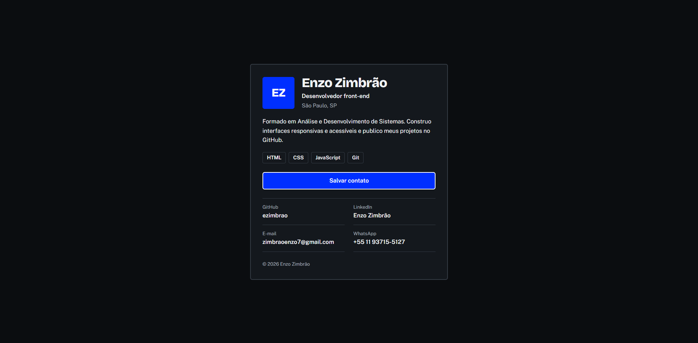

# Cartão profissional

Meu cartão de visita digital: uma página única, responsiva e acessível, com os links para meus perfis e um botão que salva meu contato direto na agenda do celular.

**Ver online:** https://ezimbrao.github.io/card-perfil/

<!-- TODO: tire um print do cartão já com seus dados reais, salve como preview.png
     na raiz do projeto e confira se a imagem aparece abaixo. -->


## O que o projeto tem

- Layout responsivo, pensado primeiro para o celular (mobile-first)
- Tema claro e escuro automático, de acordo com a preferência do sistema
- Botão "Salvar contato" que baixa um arquivo `.vcf` (vCard)
- Links para GitHub, LinkedIn, e-mail e WhatsApp
- Metadados para o link aparecer com título e descrição ao ser compartilhado (Open Graph)

## Tecnologias

- HTML5 semântico
- CSS3 puro: variáveis, Flexbox, Grid e media queries
- Fontes: Bricolage Grotesque e Public Sans (Google Fonts)
- Sem JavaScript e sem dependências

## Acessibilidade

- Estrutura com `main`, `header`, `nav` e `footer`
- Foco visível ao navegar pelo teclado (`:focus-visible`)
- Contraste de cores conferido nos dois temas
- Animações desativadas para quem pede menos movimento (`prefers-reduced-motion`)
- Áreas de toque de pelo menos 48 px nos links e no botão

## Estrutura de arquivos

```
.
├── index.html     # conteúdo e metadados da página
├── style.css      # estilos (tokens, componentes e telas maiores)
├── contato.vcf    # contato baixado pelo botão "Salvar contato"
├── preview.png    # print usado neste README
└── README.md
```

## Próximos passos

- [ ] Ícones nos links (SVG inline)
- [ ] Botão para alternar o tema manualmente
- [ ] Botão para copiar o e-mail
- [ ] Seção de projetos

## Autor

**Enzo Zimbrão** · São Paulo, SP · [GitHub](https://github.com/ezimbrao)
